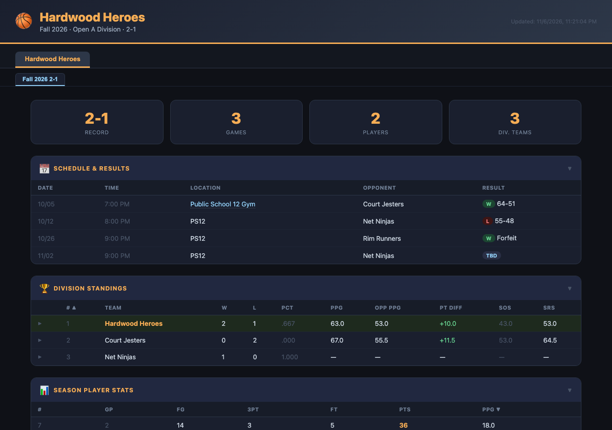

# NYUrban Basketball Dashboard



*Screenshot rendered from the sample test fixtures (fictional teams), not real league data.*

## What it does

Logs in to [nyurban.com](https://www.nyurban.com), scrapes your team's pages for every season, and publishes a static dashboard showing:

- Team name, division, record
- Game schedule & results
- Player scoring stats and per-game box scores
- Division standings, including derived points-per-game, point differential, strength of schedule (SOS) and SRS
- Division leaders

Player names are stripped from the published data; jersey numbers remain.

## Architecture

```
 nyurban.com
     │  HTTPS (login, team list, team pages)
     ▼
┌─────────────────────────── scraper/ ───────────────────────────┐
│ scraper.py   entry point: orchestrates the steps below         │
│   ├─ login.py     session, retry/backoff, login                │
│   ├─ parsing.py   HTML → dicts (pure functions, no network)    │
│   └─ storage.py   season filter/grouping, anonymize, write JSON│
└────────────────────────────────┬───────────────────────────────┘
                                 ▼
                          web/data.json   (git-ignored build artifact)
                                 ▼
                  web/index.html  (static page, fetches data.json)
```

`parsing.py` never touches the network, which is what makes it testable against saved HTML pages in `scraper/tests/fixtures/`.

## Setup & run locally

```bash
cd scraper
pip install -r requirements.txt
cp .env.example .env        # then fill in NYURBAN_USERNAME / NYURBAN_PASSWORD
python scraper.py           # optional: --season "Fall 2026"
cd ../web && python serve.py   # http://localhost:8080
```

## Tests

```bash
pip install -r scraper/requirements.txt pytest
python -m pytest scraper/tests
```

Parser tests run against saved HTML pages in [scraper/tests/fixtures/](scraper/tests/fixtures/); the network is never hit. The [Tests workflow](.github/workflows/test.yml) runs them on every pull request.

To add a fixture for a new page shape, save the page HTML, replace real names with fictional ones, drop it in `fixtures/`, and add a test in `test_parsing.py`.

## How the nightly job works

[.github/workflows/scrape-and-deploy.yml](.github/workflows/scrape-and-deploy.yml) runs daily at 06:00 UTC (2am ET) and can also be triggered manually from the Actions tab.

1. Check out the repo and install Python 3.11 plus the scraper dependencies.
2. Run `scraper/scraper.py` with `NYURBAN_USERNAME` / `NYURBAN_PASSWORD` from repository secrets. The step fails if `web/data.json` wasn't produced (e.g. login failed), so a bad run never deploys.
3. Force-push the contents of `web/` (including the fresh `data.json`) to the `gh-pages` branch, which GitHub Pages serves.

`data.json` is never committed to `main`. The page requests it with a cache-busting query string, so visitors see the latest scrape on reload.
